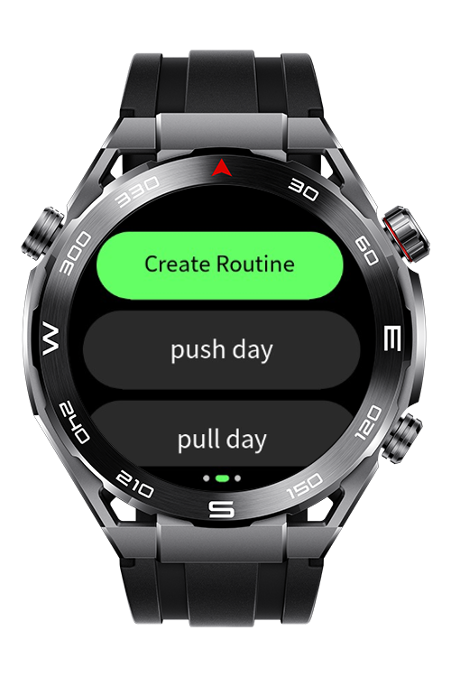
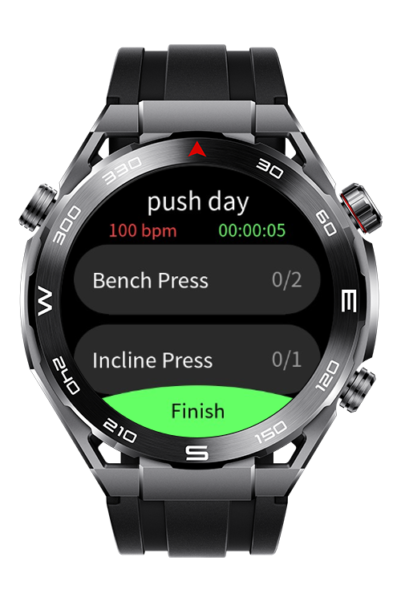
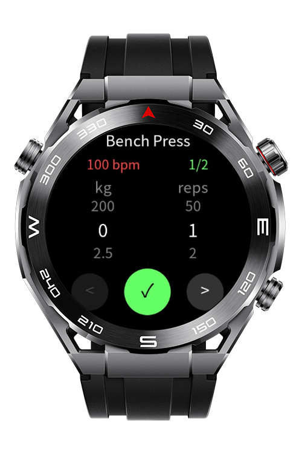
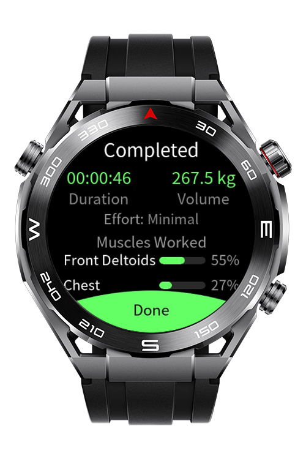

> **Note:** To access all shared projects, get information about environment setup, and view other guides, please visit [Explore-In-HMOS-Wearable Index](https://github.com/Explore-In-HMOS-Wearable/hmos-index).

# BeFit
Track your exercises, sets, reps and weight in real time - right from your wrist.

# Preview
<div>
  
  
  
  
</div>

# Use Cases
- **Start a workout:** Start a custom routine and track each movement set-by-set.
- **Live heart rate monitoring:** View your heart rate in real time during workouts.
- **Post workout summary:** Review duration, total sets, volume, effort and a muscle-group breakdown.
- **Workout History:** Browse past workouts and view detailed stats

# Tech Stack
Languages: CSS, HML, JS
Frameworks: 5.1.0(18)
Tools: DevEco Studio Version 6.0.1.251
Libraries: @system.sensor, @system.file, @system.vibrator @ohos.router

# Directory Structure
```
entry/src/main/js/MainAbility
├───common/
│   ├───models/
│   │   ├───history-data.js              # Compact history serialization
│   │   ├───movement-data.js             # Exercises & Muscle-group pairing
│   │   └───workout-data.js              # Workout, movement, routine factories
│   ├───services/
│   │   └───heart-rate-service.js        # Singleton heart rate service
│   ├───storage/
│   │   ├───file-manager.js              # @system.file wrapper
│   │   ├───history-storage.js           # Workout history CRUD
│   │   └───workout-storage.js           # Workout routine CRUD
│   ├───styles/
│   │   ├───base.css                     # Shared styles
│   │   └───popup.css                    # Shared popup style
│   └───utils/
│       ├───vibrator.js                  # @system.vibrator wrapper
├───i18n/                                # Localization files
│   ├───en-US.json
│   └───zh-CN.json
└───pages/
    ├───index/                           # Home with 3-page swiper
    ├───workout/                         # Active workout page
    ├───movement/                        # Set-kg-rep pickers
    ├───summary/                         # Workout summary
    ├───custom-routine/                  # Custom routine creation
    ├───routine-selection/               # Adding movements to a routine
    ├───routine-name-keyboard/           # Name input for a custom routine
    ├───gym-account/                     # User account info
    ├───gym-subscription/                # User gym subscription info
    ├───gym-qr/                          # Show a QR to enter a gym
    ├───gym-nearby/                      # Show nearby gyms with distance
    └───history-detail/                  # Detailed workout history
```

# Constraints and Restrictions
## Supported Devices
- Huawei Sport (Lite) Watch GT 4/5/6
- Huawei Sport (Lite) GT4/5 Pro
- Huawei Sport (Lite) Fit 3/4
- Huawei Sport (Lite) D2
- Huawei Sport (Lite) Ultimate

# LICENSE
**BeFit** is distributed under the terms of the **MIT License**.
See the [LICENSE](/LICENSE) for more information.
